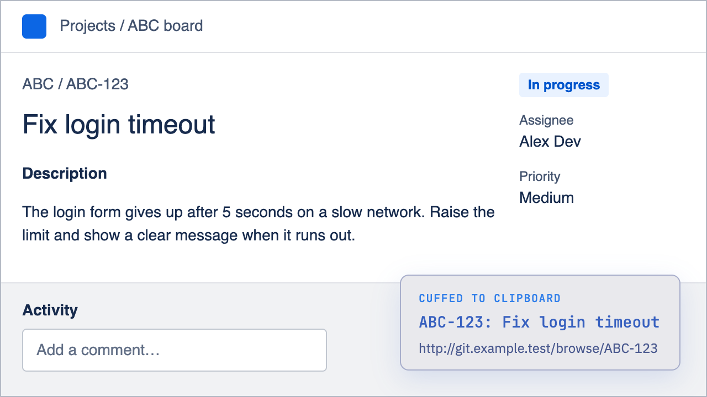

  

<h1 align="center">CuffLink</h1>

<strong>Off-the-cuff sharing, buttoned-up links.</strong>

CuffLink fastens the key and title to the Jira, GitHub and GitLab links you copy with Alt+X, so the link says what it is before anyone clicks.

  
  
  
  

## Why

A bare URL turns up to the meeting in pyjamas. Nobody knows what it is until they open it.

Typing a link with its key and title by hand is slow. CuffLink does it with one shortcut. It copies rich text for apps that keep links, and plain text for apps that do not.

## What it copies

| Page type                                                        | Label example                | Link target                                                                       |
| ---------------------------------------------------------------- | ---------------------------- | --------------------------------------------------------------------------------- |
| Jira issue page (`/browse/ABC-123`)                              | `ABC-123: Fix login timeout` | `https://<host>/browse/ABC-123`                                                   |
| Jira board, with a card selected or focused                      | `ABC-123: Fix login timeout` | `https://<host>/browse/ABC-123`                                                   |
| GitHub pull request, any tab (`/<owner>/<repo>/pull/42`)         | `my-service#42 \| Title`     | `https://<host>/octo-org/my-service/pull/42`                                      |
| GitHub issue (`/<owner>/<repo>/issues/42`)                       | `my-service#42 \| Title`     | `https://<host>/octo-org/my-service/issues/42`                                    |
| GitLab merge request, any tab (`/<project>/-/merge_requests/42`) | `my-service!42 \| Title`     | `https://<host>/group/subgroup/my-service/-/merge_requests/42`                    |
| GitLab issue (`/<project>/-/issues/42` or `/-/work_items/42`)    | `my-service#42 \| Title`     | `https://<host>/group/subgroup/my-service/-/issues/42` (or `.../-/work_items/42`) |

- **Rich text and plain text.** A normal paste gives the label as a link. Paste as plain text gives the same label with no link.
- **Any host.** CuffLink matches the URL path, not the host. It works on github.com and GitHub Enterprise, and on gitlab.com and self-managed GitLab.
- **Clean URLs.** For a Jira issue, the link is always the browse URL, not the board URL. For a pull request, merge request or issue, it is the overview URL, without the tab, query or anchor.
- **Long titles.** A label longer than 100 characters gets a cut title that ends with `…`. The `ABC-123`, `my-service!42` or `my-service#42` part is never cut, and the link target stays the full URL.

Paste as plain text:

| Where                            | Keys                                           |
| -------------------------------- | ---------------------------------------------- |
| Windows                          | Ctrl+Shift+V                                   |
| macOS Cocoa apps                 | Option-Shift-Command-V (Paste and Match Style) |
| Google Docs and similar web apps | Command-Shift-V (paste without formatting)     |

After each copy, a card in the bottom-right corner shows the result. It uses the Tokyo Night colors on a dark page and Tokyo Day on a light page.

## Install

Download the latest release zip. You do not need to clone the repo or run a build.

1. Open the [latest GitHub Release](https://github.com/joboyx/cufflink/releases/latest).
2. Download the Chrome zip.
3. Unzip the file.
4. Open `chrome://extensions`.
5. Enable Developer mode.
6. Choose Load unpacked and select the unzipped folder.

### Upgrading from Jira Link Copy

CuffLink is the new name of Jira Link Copy. The new release loads as a new extension, so do these steps once:

1. Open `chrome://extensions` and remove Jira Link Copy.
2. Load the CuffLink folder as in [Install](#install).

Remove the old extension first. Chrome does not give a shortcut to an extension when another extension already uses it, so CuffLink gets Alt+X only when Jira Link Copy is gone. A shortcut that you changed for Jira Link Copy does not carry over: set it again in `chrome://extensions/shortcuts`.

## Shortcut

Default: Alt+X (Option+X on Mac). Change the shortcut in `chrome://extensions/shortcuts`.

Click the toolbar icon to copy the same way.

## Permissions

| Permission       | Why                                                                      |
| ---------------- | ------------------------------------------------------------------------ |
| `activeTab`      | Read the active tab, only after you press the shortcut or click the icon |
| `scripting`      | Inject the copy script into that tab                                     |
| `clipboardWrite` | Write the link to the clipboard                                          |

CuffLink does not request host access to any site. It collects, stores and sends no data; see the [privacy policy](PRIVACY.md).

## Limitations

- **Active tab only, on request.** CuffLink acts only on the active tab, and only when you press the shortcut or click the toolbar icon.
- **Title fallback.** The title comes from the page heading. When the page has no heading yet, the title comes from the tab title. When the tab title has no usable title, the label is only the key, such as `ABC-123`.
- **No group-level GitLab work items.** A work item at the group level (`/groups/<group>/-/work_items/42`, such as an epic) is not supported.
- **No match.** On a page with no issue, pull request or merge request, the card shows `Nothing to cuff`.
- **Browser pages.** Chrome does not let an extension run on its own pages, such as `chrome://` pages. There, the toolbar icon shows a red `!` badge for 2 seconds.

## Develop

Requires Node 20 or newer (`.nvmrc` pins 22).

1. Run `npm ci`.
2. Run `npm run build`.
3. In `chrome://extensions`, choose Load unpacked and select `.output/chrome-mv3`.

`npm start` builds in watch mode. `npm test` runs lint, type coverage, unit tests and the build. The full command list and the code layout are in [CONTRIBUTING.md](CONTRIBUTING.md).

### Release

Every merge to `main` publishes the next patch release from the latest tag, with the Chrome zip attached.

The `package.json` version is the base. A pull request that raises it releases that version instead:
`npm version X.Y.0 --no-git-tag-version`.

## Fonts and acknowledgements

The card uses [JetBrains Mono](https://github.com/JetBrains/JetBrainsMono) and [IBM Plex Sans](https://github.com/IBM/plex). They are bundled in `public/fonts` because many Jira sites block web font hosts. Both fonts use the [SIL Open Font License 1.1](https://openfontlicense.org). License files: [`public/fonts/OFL-JetBrainsMono.txt`](public/fonts/OFL-JetBrainsMono.txt) and [`public/fonts/OFL-IBMPlexSans.txt`](public/fonts/OFL-IBMPlexSans.txt).

## Contributing

See [CONTRIBUTING.md](CONTRIBUTING.md) and the [Code of Conduct](CODE_OF_CONDUCT.md).

## Security

To report a security problem, see [SECURITY.md](SECURITY.md).

## License

MIT. See [LICENSE](LICENSE).
